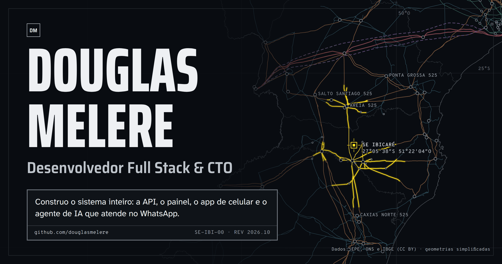
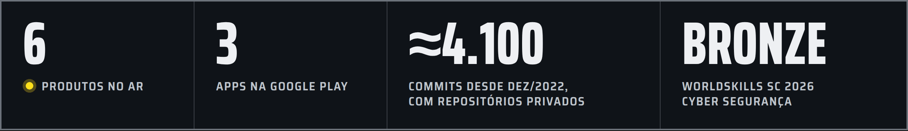
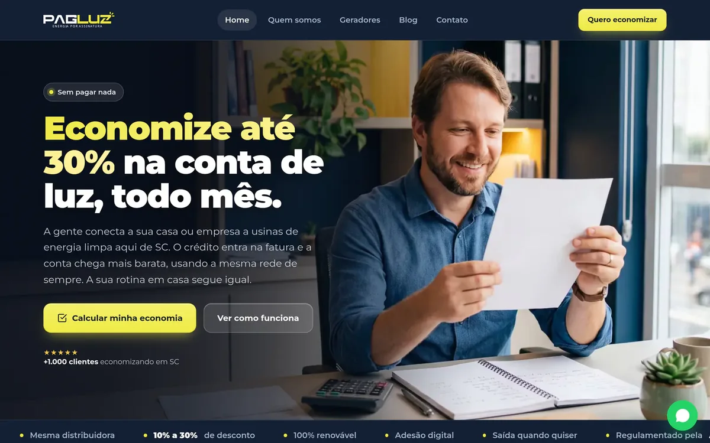
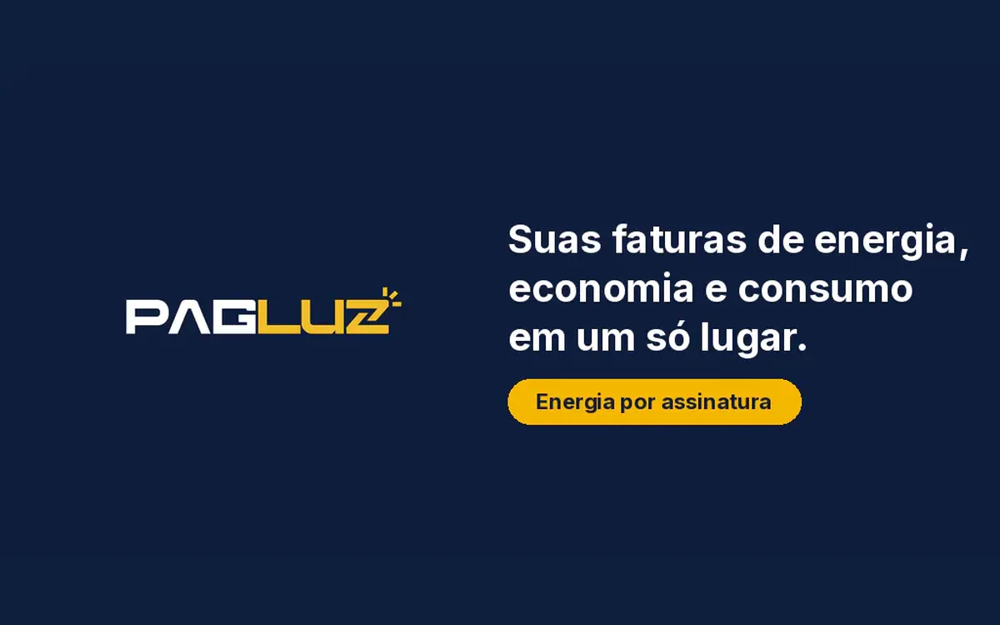
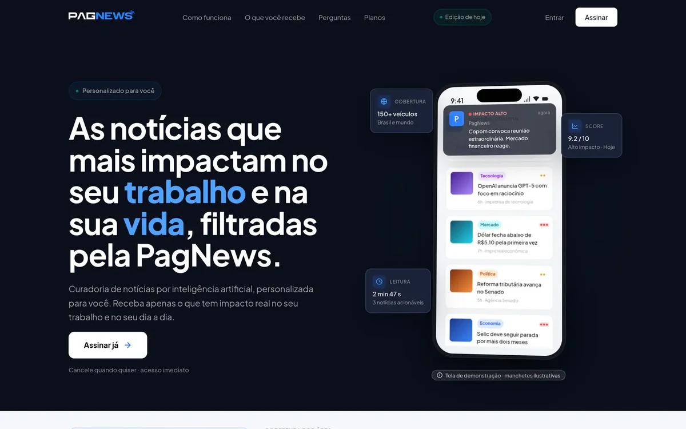
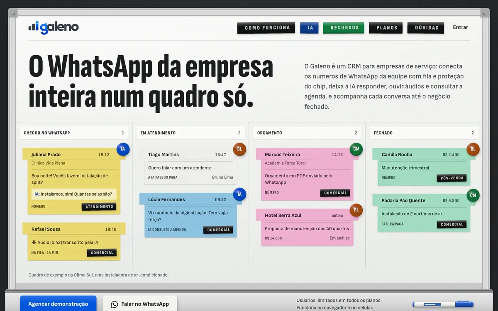
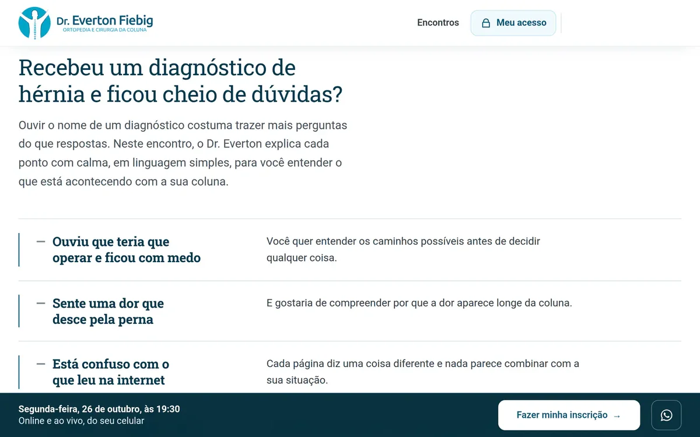
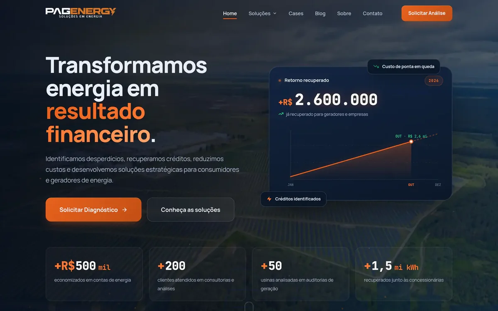
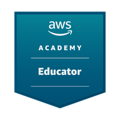

  

  
  
  

Sou CTO do Grupo Pag (PagLuz, PAGENERGY e PagNews) e escrevo o código da plataforma que opera o grupo. Também dou aula no SENAI Luzerna e desenvolvo sistemas, apps e automações com IA para outras empresas.

  

## Em produção

A maior parte do que eu construo roda em repositório privado. Por isso os links abaixo levam ao produto, não ao código.

<table>
  <tr>
    <td width="50%" valign="top">
      
      <h3>Plataforma Grupo Pag</h3>
      
O sistema que opera uma empresa de energia por assinatura, do primeiro contato no WhatsApp à fatura e à comissão.

      
Tirei a operação das planilhas e dos fluxos no n8n: uma API modular em NestJS (51 módulos, cerca de 580 arquivos de teste), o painel que opera todas as empresas do grupo, uma central de WhatsApp com agente de IA e um motor de automações.

      
<code>NestJS</code> <code>Prisma</code> <code>PostgreSQL</code> <code>Redis/BullMQ</code> <code>React</code> <code>Docker</code>

      
Na imagem, o site público. O painel tem dados de clientes e não aparece aqui.

    </td>
    <td width="50%" valign="top">
      
      <h3>Apps PagLuz</h3>
      
O cliente acompanha faturas, economia e consumo e paga por Pix. O representante cadastra clientes na rua fotografando a conta de luz e gera a proposta em PDF.

      
Dois apps em React com Capacitor, na web e na Google Play. O app do cliente fala só com um BFF dentro da API, então o token que enxerga todos os clientes nunca vai para o celular.

      
<code>React</code> <code>Capacitor</code> <code>TypeScript</code> <code>PWA</code>

      
<a href="https://meu.pagluz.com.br">App na web</a> · <a href="https://play.google.com/store/apps/details?id=br.com.pagluz.app">Cliente na Play</a> · <a href="https://play.google.com/store/apps/details?id=br.com.pagluz.representante">Representantes na Play</a>

    </td>
  </tr>
  <tr>
    <td width="50%" valign="top">
      
      <h3>PagNews</h3>
      
Notícias do seu setor filtradas por IA, por e-mail, na web e no app Android.

      
Respondo pelo desenvolvimento técnico (o produto tem sócios). O pipeline coleta as matérias, remove as duplicadas, classifica cada uma com LLM e calcula quanto ela importa para cada assinante. Uma etiqueta só vai para produção se passar num teste contra um conjunto de referência.

      
<code>NestJS</code> <code>PostgreSQL</code> <code>React</code> <code>Capacitor</code> <code>LLM</code> <code>Stripe</code>

      
<a href="https://pagnews.com.br">pagnews.com.br</a> · <a href="https://play.google.com/store/apps/details?id=br.com.pagluz.news">Google Play</a>

    </td>
    <td width="50%" valign="top">
      
      <h3>Galeno CRM</h3>
      
Um CRM para empresas que vendem pelo WhatsApp: os números da equipe numa fila só e agentes de IA que atendem, consultam a agenda e passam a conversa para uma pessoa.

      
Criei sozinho e mantenho o produto. A Trovão Brasil já usa o sistema com a própria marca, no plano white-label.

      
<code>Fastify</code> <code>WebSocket</code> <code>BullMQ</code> <code>PostgreSQL + pgvector</code> <code>React</code>

      
<a href="https://galenocrm.com.br">galenocrm.com.br</a>

    </td>
  </tr>
  <tr>
    <td width="50%" valign="top">
      
      <h3>Encontros com o Dr. Everton Fiebig</h3>
      
Inscrição e pagamento dos encontros online de um médico, feitos para um público que usa quase só o celular.

      
A equipe dele publica cada encontro pelo painel, sem código e sem deploy, e acompanha inscritos e pagamentos.

      
<code>vinext</code> <code>React</code> <code>PostgreSQL</code> <code>Prisma</code> <code>Docker</code>

      
<a href="https://encontros.drevertonfiebig.com.br">encontros.drevertonfiebig.com.br</a>

    </td>
    <td width="50%" valign="top">
      
      <h3>Sites PagLuz e PAGENERGY</h3>
      
Os sites do grupo em vinext: páginas reais e indexáveis, servidas por Node no Coolify.

      
Converti o site da PagLuz de um HTML de arquivo único para o App Router sem mudar o visual. No da PAGENERGY, troquei uma SPA com rotas por hash por páginas com blog, SEO por página e sitemap.

      
<code>vinext</code> <code>React</code> <code>TypeScript</code> <code>SEO</code> <code>Docker</code>

      
<a href="https://pagluz.com.br">pagluz.com.br</a> · <a href="https://pagenergy.com.br">pagenergy.com.br</a>

    </td>
  </tr>
</table>

## Código aberto

| Projeto | O que é | Tecnologias |
| --- | --- | --- |
| [Reserva de Notebooks](https://github.com/douglasmelere/reserva-notebooks) | Reserva e gestão de notebooks, maletas e carrinhos para uma instituição de ensino, com inventário, ocorrências e relatórios. Feito para o SENAI/SC. | React, TypeScript, PostgreSQL, Prisma, Vitest, Playwright |
| [Quiz de Requisitos](https://github.com/douglasmelere/quiz-requisitos) | Quiz em equipes para ensinar requisitos de software, com telão, placar ao vivo e persistência das partidas. | Node.js, SSE, Docker, sem dependências |
| [Kart Kids](https://github.com/douglasmelere/kart-kids) | Jogo de corrida 2D multiplayer com salas públicas e privadas, bots e ranking persistente. | Phaser, Socket.IO, Node.js, SQLite |
| [Handbook Offline](https://github.com/douglasmelere/handbook-offline) | Manual de campo de segurança para estudo e CTF: infraestrutura, defesa, ataque e forense numa página só. | HTML, Docker |

## Ensino

Sou professor no SENAI Luzerna (Especialista de Ensino II), nas unidades de Modelagem de Sistemas, Desenvolvimento de APIs, Codificação para Back-End e Versionamento e Colaboração. Sou [educador credenciado AWS Academy](https://www.credly.com/badges/136efb49-947f-4b7c-9d11-afb31a52a608/public_url).

Também oriento projetos de alunos, como o LibraIA, um tradutor de Libras para português falado que roda no navegador.

## Tecnologias

  

- **Back-end:** TypeScript, Node.js, NestJS, Fastify, PostgreSQL, Prisma, Redis e BullMQ.
- **Front-end e mobile:** React, Vite, Tailwind CSS e Capacitor.
- **IA:** agentes com LLM no WhatsApp, classificação de conteúdo e busca com pgvector.
- **Entrega:** Docker, Coolify, GitHub Actions e observabilidade.

## Formação

Formação em Análise e Desenvolvimento de Sistemas e Técnico em Informática para Internet. Em estudo: inteligência artificial e ciência de dados.

## Contato

Para projetos, oportunidades ou colaboração, fale comigo pelo [LinkedIn](https://www.linkedin.com/in/douglas-melere-22840b2a4/) ou pelo [e-mail](mailto:douglasmelere@gmail.com).
